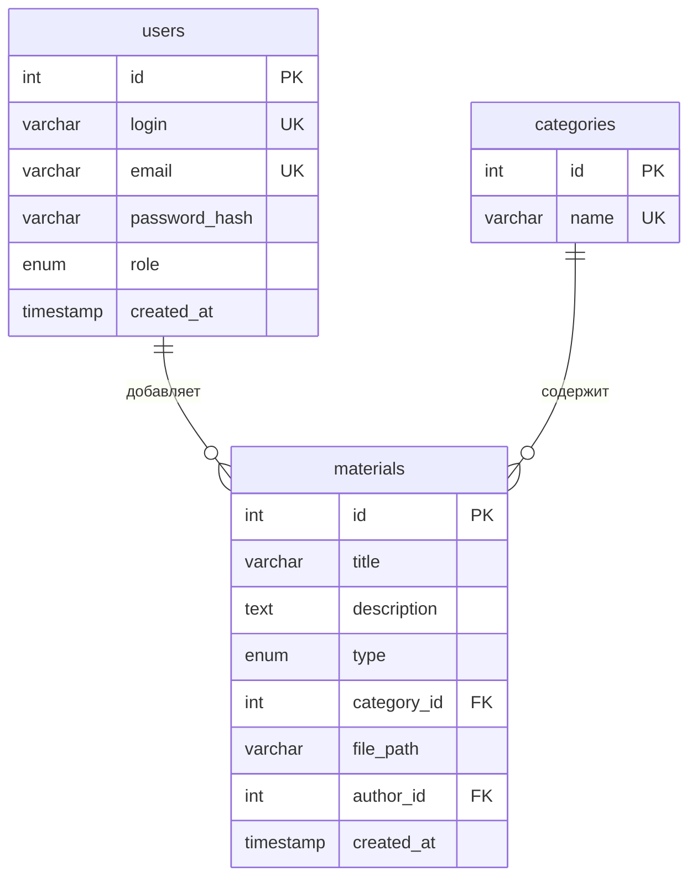

# База данных

СУБД: MySQL 8 / MariaDB (XAMPP). База `multimedia_gallery`, кодировка `utf8mb4`.
Создаётся командой `npm run db:init` (файлы `database/schema.sql` и `database/seed.sql`).

## Схема



## Таблицы

**users** — пользователи

| Поле | Тип | Описание |
|---|---|---|
| id | INT, автоинкремент | идентификатор |
| login | VARCHAR(50), уникальный | логин |
| email | VARCHAR(100), уникальный | электронная почта |
| password_hash | VARCHAR(255) | хэш пароля (bcrypt) |
| role | ENUM('user','admin') | роль, по умолчанию user |
| created_at | TIMESTAMP | дата регистрации |

**categories** — категории (Фотографии, Музыка, Обучение, Развлечения, Другое)

| Поле | Тип | Описание |
|---|---|---|
| id | INT, автоинкремент | идентификатор |
| name | VARCHAR(50), уникальный | название |

**materials** — материалы галереи

| Поле | Тип | Описание |
|---|---|---|
| id | INT, автоинкремент | идентификатор |
| title | VARCHAR(150) | название |
| description | TEXT | описание |
| type | ENUM('image','video','audio') | тип материала |
| category_id | INT, внешний ключ | категория (`categories.id`) |
| file_path | VARCHAR(500) | путь к файлу (`/uploads/...`) или ссылка на видео |
| author_id | INT, внешний ключ | автор (`users.id`), при удалении пользователя его материалы удаляются |
| created_at | TIMESTAMP | дата добавления |

Индексы таблицы materials: по типу, по автору, по дате добавления.

## Копия и восстановление (XAMPP)

```
C:\xampp\mysql\bin\mysqldump -u root --databases multimedia_gallery --result-file=backup.sql
C:\xampp\mysql\bin\mysql -u root -e "source backup.sql"
```

Файлы загруженных материалов хранятся не в базе, а в папке `uploads`, при копии базы их нужно сохранять отдельно.
